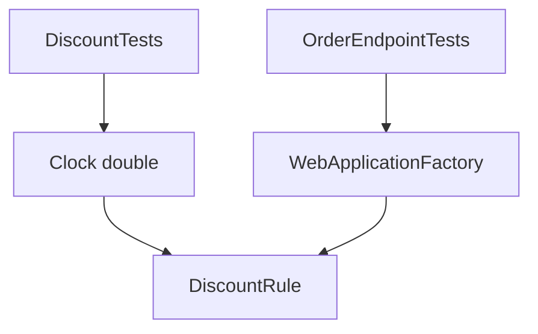

# lab-dotnet-testing

A discount rule, the unit tests that can prove it, and the HTTP host those tests never start.

.NET 10. HTTP on port **5044**. Swagger UI in Development: [http://localhost:5044/swagger](http://localhost:5044/swagger).

The host clock is fixed at 11:00. A valid order is 10 percent off. The unit tests pass their own clock, so noon does not depend on the machine.

## Run

```powershell
dotnet test
dotnet run --project src/LabDotnetTesting.Api
```

Open `LabDotnetTesting.slnx` and start the `http` profile. The OpenAPI document is `/openapi/v1.json`. Swagger is not registered outside Development.

`dotnet test --filter DiscountTests` does not listen on a port. `dotnet test --filter OrderEndpointTests` boots the API in memory.

## What each suite owns



| Test | What it proves |
| --- | --- |
| `DiscountTests.AppliesTenPercentBeforeNoon` | 100 at 11:00 becomes 90. The clock is a Moq double. The rule is real. |
| `DiscountTests.NoDiscountAfterNoon` | 100 at 13:00 stays 100. |
| `OrderEndpointTests.MissingCustomerIs400` | `POST /orders` without a customer is 400. |
| `OrderEndpointTests.PricedOrder` | The same 90, through model binding and the registered clock. |
| `OrderEndpointTests.MissingClock` | A host that does not register `IClock` returns 500. `DiscountTests` does not build that host. |

The double answers one question: what time is it. It does not return the total. A mock of `DiscountRule` would stay green after the rule was deleted.

## Request

`POST /orders`

```json
{ "customer": "Ada", "amount": 100 }
```

| Body | Status | Total |
| --- | --- | --- |
| Customer and a positive amount | 200 | 90 while the host clock is 11:00 |
| Missing customer | 400 | |
| Host built with `Lab:Clock` = `missing` | 500 | The rule does not run |

The running API does not use `missing`. That value exists so the integration test can build the broken host on purpose.

## Endpoints

| Method | Path | Result |
| --- | --- | --- |
| GET | `/health` | 200 liveness. |
| POST | `/orders` | Priced order, 400, or 500 when the clock was not registered. |

## Configuration

`Lab:Clock` defaults to `fixed`. Any value other than `missing` registers a clock at 11:00 on 1 June 2026.

---

I hope the split between the rule and the host in this repository helps you notice what a green unit suite did not run.

Sevann Radhak
